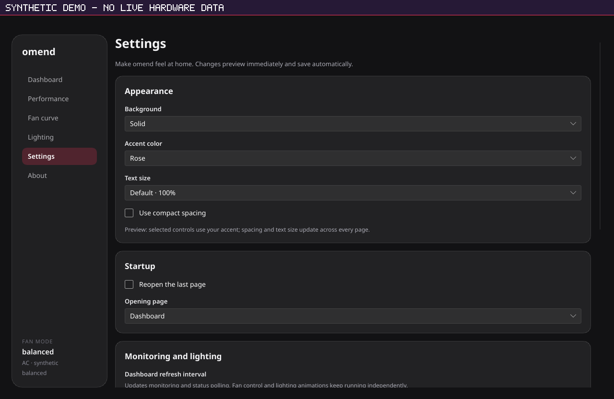

# omend — HP OMEN/Victus controls for Linux

An experimental Rust desktop application and service for inspecting temperatures,
controlling fan curves, selecting platform power profiles, and configuring keyboard
lighting on some HP OMEN/Victus laptops. This is an independent project, not an HP
product or an endorsement by HP.

**Status: development preview; hardware safety validation is incomplete.** The
recorded OMEN 16-xf0xxx shutdown test requested firmware Auto but aborted at 83°C
with both fans reporting zero RPM. The cause remains unresolved. A separate
maximum-fan recovery option exists, is disabled by default, and has not been
physically validated. Passing software tests do not establish safe cooling.
Read [hardware support](docs/support-hardware.md), [daemon safety](docs/daemon-safety.md)
and the [validation record](docs/hardware-validation.md) before installing.



Synthetic headless Settings preview; no live hardware data. Dashboard gauge
rotation is not represented faithfully by this test renderer.

## Known issues

- **Fans may stay at 0 RPM after control is returned to firmware.** On the
  OMEN 16-xf0xxx, stopping the daemon requested firmware Auto, yet both fans
  read 0 RPM while the CPU reached 83°C, and the test was aborted. The cause is
  unresolved. The service's `ExecStopPost` recovery requests the same Auto
  mode, so it does not avoid this. Until this is resolved: treat custom fan
  curves as experimental, watch temperatures after stopping, restarting,
  upgrading or removing `omend`, and if the fans do not spin up under load,
  stop the workload and reboot to let the firmware reset fan control. See
  [hardware validation](docs/hardware-validation.md).
- The optional kernel module, the hardened service unit and suspend/resume
  handling have not been validated on hardware.

## Components

| Component | Purpose |
| --- | --- |
| `omend` | Privileged system D-Bus service for hardware control |
| `omen-cli` | Status, read-only hardware inspection, and authorized control |
| `omen-gui` | Slint desktop interface |
| `omen-audio` | Optional user-session speaker-output analysis for audio lighting |
| `kernel/omen-kbd` | Optional experimental keyboard backlight module |

Availability depends on the kernel, firmware and device interfaces. Four-zone
lighting does not provide per-key control. The kernel module is separate from the
userspace bundle and is not required for read-only inspection.

## Build and inspect

Use Linux and the repository's Rust 1.99.0 toolchain. This is the tested build
baseline, not a claim about the minimum supported Rust version. Install `rustfmt`
and `clippy` for development. The GUI needs native font,
window-system and graphics development libraries for its Slint backends, including
Fontconfig, FreeType, xkbcommon, Wayland/X11 and EGL/OpenGL support as appropriate
to the distribution. A C/C++ toolchain, linker and `pkg-config` may be needed by
native dependencies. A portable binary baseline and distribution support matrix
have not been established. The configured Ubuntu 24.04 CI package list is in
[validation setup](docs/release-validation.md#configured-native-build-setup);
that workflow has not yet established a passing hosted build or runtime baseline.

```sh
cargo build --workspace --release --locked
./target/release/omen-cli doctor
```

`doctor` inspects sysfs without starting a daemon or writing hardware settings.
Its success means an interface was found, not that fan control is safe or supported.
Builds and ordinary tests do not install services. Dependencies must be available
before using `--offline`.

For development checks:

```sh
cargo fmt --all -- --check
cargo test --workspace --release --locked
cargo clippy --workspace --all-targets --release --locked
```

Tests use isolated files and private D-Bus instances; install `dbus-daemon` for
those checks. Run tests as an ordinary user. Native builds can generate load and
heat even though they do not deliberately exercise hardware controls.

## Installation and desktop integration

Create a local host-specific archive with:

```sh
sh packaging/build-release.sh
```

Artifacts go under `dist/`. Follow [binary installation](docs/binary-install.md)
or [installation from source](docs/system-install.md). Installed executables must
be independent of the checkout and `target/`; check old launchers and services
before deleting build output. Local archives are not a verified portable release.

The system service runs as root; clients run as your normal user. The packaged
D-Bus policy reserves mutations for root and the `omen` group. Group membership
grants persistent hardware-control trust, including background/remote sessions.
Upgrade the policy together with the daemon. A session daemon is read-only.

Audio lighting additionally needs `parec` and `pactl` from PulseAudio utilities,
with PulseAudio or PipeWire's PulseAudio compatibility service. `wpctl`, `wl-copy`
and `wl-paste` support optional desktop integrations. See [audio lighting](docs/audio-visualizer.md),
[GUI settings](docs/gui-settings.md), [privacy](docs/privacy.md), and the
[optional kernel module](docs/kernel-module.md).

## Contributing and reporting

Read [CONTRIBUTING.md](CONTRIBUTING.md) for development and reporting guidance,
[SECURITY.md](SECURITY.md) before reporting a vulnerability, and
[CHANGELOG.md](CHANGELOG.md) for unreleased work. Report bugs at
<https://github.com/alanfrancis442/omend/issues> and vulnerabilities privately
as described in SECURITY.md.
The [release checklist](docs/release-checklist.md) tracks remaining validation.
The [validation gates](docs/release-validation.md) define the required sign-off
evidence and distinguish automated checks from physical testing.

## License

Project userspace code is available under **MIT OR Apache-2.0**; the optional
kernel module is **GPL-2.0-only**. See [LICENSE](LICENSE) and [LICENSES](LICENSES).
Dependencies retain their own licenses. The selected Slint royalty-free desktop
route uses the AboutSlint widget on the GUI About page. Generated third-party
notices and redistribution obligations still require review before shipping
binaries; see [Licensing](docs/licensing.md).
